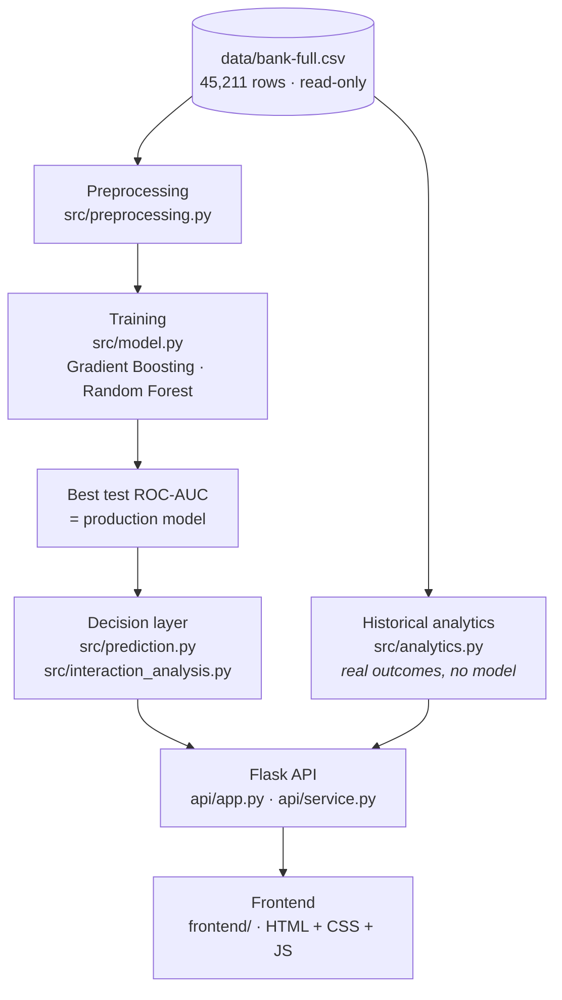
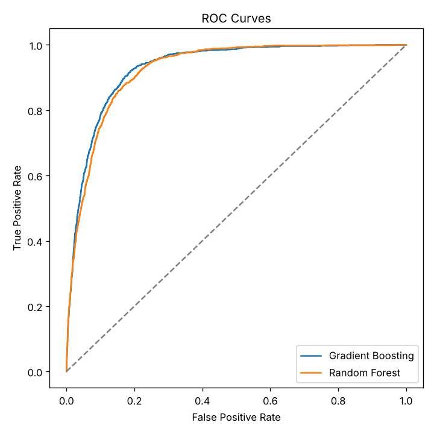
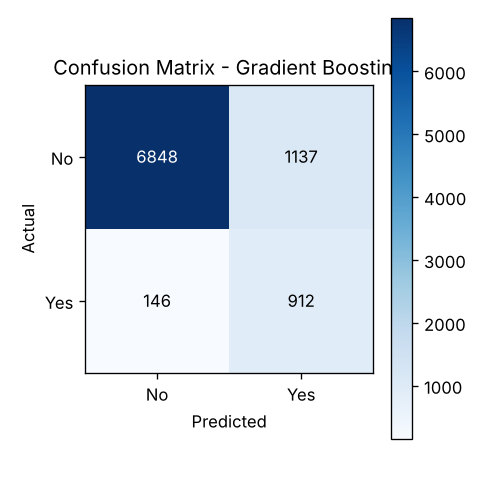

<div align="center">

# 🏦 Bank Marketing — Decision Support System

### From *"what's our conversion rate?"* to *"who should we call next, and what should we say?"*

A prototype marketing analytics dashboard built on the **UCI Bank Marketing dataset**.
It combines honest historical campaign analysis with machine-learning lead scoring
and plain-English next-action recommendations.

<p>
  
  
  
  
  
  
</p>

<p>
  <a href="#-quick-start">Quick start</a> ·
  <a href="#-dashboard-tour">Dashboard</a> ·
  <a href="#-how-it-works">How it works</a> ·
  <a href="#-api-reference">API</a> ·
  <a href="#-limitations">Limitations</a>
</p>


</div>

---

## 📖 Table of contents

- [Overview](#-overview)
- [Highlights](#-highlights)
- [Dashboard tour](#-dashboard-tour)
- [Tech stack](#-tech-stack)
- [Quick start](#-quick-start)
- [How it works](#-how-it-works)
- [Model results](#-model-results)
- [API reference](#-api-reference)
- [Project structure](#-project-structure)
- [Retraining the models](#-retraining-the-models)
- [Testing](#-testing)
- [Deployment notes](#-deployment-notes)
- [Troubleshooting](#-troubleshooting)
- [Limitations](#-limitations)
- [Future improvements](#-future-improvements)
- [Contributing](#-contributing)
- [License and data citation](#-license-and-data-citation)

---

## 🎯 Overview

A bank runs phone campaigns to sell term deposits. Calling everyone is expensive, and calling the same person too often is counter-productive. This project answers four questions, in order:

| # | Question | Answered by |
|---|---|---|
| 1 | How is the campaign performing overall? | Historical analysis |
| 2 | Which customer and campaign factors go with conversion? | Historical analysis |
| 3 | Who is most likely to subscribe? | Model prediction |
| 4 | What should the bank do next for each customer? | Rule-based recommendation |

> [!IMPORTANT]
> **This is a prototype.** It is not connected to a live bank CRM. The dashboard shows historical campaign analysis, predictions for the held-out test portion of the UCI dataset, and a form that scores one manually entered customer.

## ✨ Highlights

- 📊 **Four-section dashboard** with a shared filter row (age group, job, education, marital status, housing loan, personal loan, campaign month, previous outcome).
- 🧪 **Two models, one comparison:** Gradient Boosting and Random Forest are trained on the same split; the one with the best test ROC-AUC becomes the production model.
- 🌡️ **Decision layer** turns a raw probability into a **Lead Temperature** (HOT / WARM / COLD), an **Interaction Pattern**, a **Contact Fatigue** level and a plain-English **Recommendation**.
- 🔎 **Honest by design:** historical numbers (real outcomes) and model-predicted numbers are kept separate and labelled on every page.
- 🧮 **Score a new customer** through a validated form that uses the same saved preprocessor and models.
- 📥 **CSV export** of the filtered, ranked customer list.
- 🪶 **Lightweight frontend:** no framework, no build step, no JS packages; dependency-free SVG charts with tooltips and table views; responsive layout; light/dark theme follows the OS.
- 🔒 **No leakage:** the preprocessor is fit on the training split only, and the saved feature order is validated at startup.

## 🖼️ Dashboard tour

<table>
  <tr>
    <td width="50%" align="center">
      <br>
      <b>Executive overview</b><br>
      <sub>Headline conversion, monthly trends, lead snapshot</sub>
    </td>
    <td width="50%" align="center">
      <br>
      <b>Campaign insights</b><br>
      <sub>Conversion drivers and customer segments</sub>
    </td>
  </tr>
  <tr>
    <td width="50%" align="center">
      <br>
      <b>Actionable targeting</b><br>
      <sub>Ranked leads, recommendations, score a new customer</sub>
    </td>
    <td width="50%" align="center">
      <br>
      <b>Model performance</b><br>
      <sub>Metrics, ROC, confusion matrices, feature importance</sub>
    </td>
  </tr>
</table>

<details>
<summary><b>What each section does</b></summary>

<br>

| Section | Data source | What you get |
|---|---|---|
| **Executive overview** | Historical (all 45,211 rows) + model snapshot | Headline sentence, contacts per customer, best job segment and strongest month (groups of 30+ only), hot-lead count, conversion and volume by month, HOT/WARM/COLD split |
| **Campaign insights** | Historical | Conversion by month, current-campaign contacts, previous outcome and call duration, plus a segment explorer (age group, job, education, marital status, housing loan, personal loan, credit default). Groups under 30 customers are drawn faded and flagged, not hidden |
| **Actionable targeting** | Model-predicted (9,043 held-out customers) | Switch between the two models; KPI strip that doubles as quick filters; probability histogram with 40% / 70% thresholds; recommendation mix; paginated (25 rows), sortable, searchable customer table; customer detail view; CSV export; **Score a new customer** form |
| **Model performance** | Model-predicted (full test set) | Metric comparison, ROC curves, feature importance per model (one-hot columns summed back to their input field), confusion matrices at the 0.5 threshold |

Every chart has hover tooltips, and most have a **Table** toggle that shows the exact numbers.

</details>

## 🧰 Tech stack

| Layer | Technology |
|---|---|
| **Language** | Python 3.10+ (verified with 3.13) |
| **Data and ML** | pandas, NumPy, scikit-learn (`GradientBoostingClassifier`, `RandomForestClassifier`, `ColumnTransformer`), joblib |
| **Reporting images** | matplotlib (training-time plots in `outputs/`) |
| **API / server** | Flask 3.x, JSON endpoints, serves the static frontend |
| **Frontend** | HTML, CSS, vanilla JavaScript, custom SVG charts. No build step |
| **Dev / testing** | pytest, Playwright (optional, listed in `requirements-dev.txt`) |

## 🚀 Quick start

### Prerequisites

- **Python 3.10 or newer** and `pip`
- A modern browser
- No database, API keys or environment variables are needed

### Install and run

```bash
# 1. Get the code (replace the URL with your repository's)
git clone <your-repo-url>
cd Bank_marketing_project

# 2. Create and activate a virtual environment
python -m venv .venv
source .venv/bin/activate          # macOS / Linux
# .venv\Scripts\activate           # Windows

# 3. Install dependencies
python -m pip install -r requirements.txt

# 4. Start the dashboard
python run.py
```

Then open **http://localhost:5000**. Trained models and outputs already ship in `models/` and `outputs/`, so no training step is required.

### Run options

```bash
python run.py --port 8080        # use another port
python run.py --host 0.0.0.0     # reachable from other devices on your network
python run.py --debug            # Flask debug mode
```

### One-step launchers

`run_project.bat` (Windows) and `run_project.sh` (macOS / Linux) install dependencies, train only if `models/production_model.json` is missing, then start the server. The Windows launcher also opens your browser.

```bash
bash run_project.sh
```

> [!NOTE]
> The shipped `models/*.joblib` were saved with **scikit-learn 1.9.1**. If your installed version differs and you see warnings (or load errors), run `python train_and_evaluate.py` to rebuild the artifacts for your environment.

## 🧠 How it works



**One implementation, reused everywhere.** Preprocessing, models, rules and recommendation logic live only in `src/`. `train_and_evaluate.py` is the single training entry point; the API only loads saved artifacts and never retrains; the frontend only talks to the API.

### 1. Preprocessing (`src/preprocessing.py`)

- `"unknown"` values (for example `poutcome` is unknown for ~82% of rows) are kept as their own category. Any genuine NaNs are filled defensively.
- Numeric columns (`age`, `balance`, `day`, `duration`, `campaign`, `pdays`, `previous`) use `StandardScaler`; categorical columns use `OneHotEncoder(handle_unknown="ignore")`.
- Stratified **80/20** split, `random_state=42`: 36,168 train / 9,043 test.
- The transformer is fit on the **training split only**.
- The resulting **51-column** feature order is saved to `models/feature_order.json` and validated whenever the API loads artifacts.

### 2. Models (`src/model.py`)

| Model | Configuration |
|---|---|
| **Gradient Boosting** | `n_estimators=300`, `learning_rate=0.1`, `max_depth=4`, `subsample=0.9`, balanced sample weights |
| **Random Forest** | `n_estimators=200`, `max_depth=12`, `class_weight="balanced"` |

Both use `random_state=42` and the same split. `train_and_evaluate.py` picks the higher test ROC-AUC as the production model and records it in `models/production_model.json`.

### 3. Decision layer

The model produces **one number**: the probability that a customer subscribes. Everything else is a transparent, **project-created rule** (not an official UCI label).

<table>
<tr>
<td valign="top" width="33%">

**Lead temperature**<br>
<sub><code>src/prediction.py</code></sub>

| Probability | Label |
|---|---|
| ≥ 0.70 | 🔴 HOT |
| 0.40 – 0.70 | 🟠 WARM |
| < 0.40 | 🔵 COLD |

</td>
<td valign="top" width="33%">

**Contact fatigue**<br>
<sub>from <code>campaign</code></sub>

| Contacts | Level |
|---|---|
| ≤ 2 | LOW |
| 3 – 4 | MEDIUM |
| ≥ 5 | HIGH |

</td>
<td valign="top" width="34%">

**Interaction pattern**<br>
<sub><code>src/interaction_analysis.py</code></sub>

First match wins:
Interested · Repeatedly Contacted · No Previous Interaction · Previously Unsuccessful · Unclear

</td>
</tr>
</table>

<details>
<summary><b>Interaction pattern rules and recommendation examples</b></summary>

<br>

| Pattern | Rule (built from `campaign`, `previous`, `poutcome`) |
|---|---|
| **Interested** | Previous campaign was a success **and** current contact count is low (≤ 3) |
| **Repeatedly Contacted** | Current contact count is high (> 3) **and** previous outcome was not a success |
| **No Previous Interaction** | `previous == 0` |
| **Previously Unsuccessful** | `poutcome == "failure"` |
| **Unclear** | None of the above |

The three outputs combine into a **Recommendation** via a small lookup (`recommend_action` in `src/prediction.py`). Contact fatigue is checked first within each temperature bucket. Examples:

- HOT + Interested + LOW → *"Prioritize follow-up soon - strong positive signal."*
- HOT + Repeatedly Contacted + HIGH → *"High conversion potential, but avoid excessive contact."*
- COLD + Repeatedly Contacted + HIGH → *"Low priority and already over-contacted - stop further outreach for now."*

</details>

### ⚠️ The `duration` assumption

`duration` (length of the last call) is only known **after** a call ends. This project is explicitly a **post-interaction** prototype supporting *follow-up* decisions, so `duration` is kept, and this is stated in the dashboard footer and scoring form. A **pre-call** system (deciding whom to call first) must drop `duration` and retrain.

## 📈 Model results

Held-out test set of **9,043** customers, 0.5 decision threshold (source: `outputs/model_comparison.csv`):

| Model | Accuracy | Precision | Recall | F1 | ROC-AUC | PR-AUC |
|---|---|---|---|---|---|---|
| 🏆 **Gradient Boosting** *(production)* | **0.858** | **0.445** | **0.862** | **0.587** | **0.930** | **0.621** |
| Random Forest | 0.846 | 0.423 | 0.861 | 0.567 | 0.924 | 0.603 |

Gradient Boosting leads on every metric in this run, but the margins are small. Positive-class precision is moderate (~0.44) because balanced weighting trades precision for recall on the ~88/12 imbalanced target.

<p align="center">
  
  
</p>

Lead split of the 9,043 scored test customers (`outputs/run_summary.json`): **1,453 HOT**, **837 WARM**, **6,753 COLD**.

### Output files

| File | Contents |
|---|---|
| `outputs/final_predictions.csv` | Every test customer with probability, lead temperature, interaction pattern, contact fatigue and recommendation, sorted by probability |
| `outputs/top_priority_customers.csv` | Top 50 by conversion probability |
| `outputs/model_comparison.csv` | Metrics for both models |
| `outputs/run_summary.json` | Machine-readable run summary |

> `customer_record_id` is generated from each row's position in the test split. The UCI dataset has **no real customer identifier**.

## 🔌 API reference

All endpoints return JSON except the CSV export. Filters are query parameters and may repeat (`?job=student&job=retired&month=mar`). `model` is `gradient_boosting` or `random_forest` (default: the production model). Invalid input returns HTTP 400 with `{"error": "..."}`.

| Method | Endpoint | Returns |
|---|---|---|
| `GET` | `/api/health` | Status, startup time, production model |
| `GET` | `/api/meta` | Filter options, models, segments, thresholds, form options and ranges |
| `GET` | `/api/overview` | Historical KPIs, conversion by month, best job segment |
| `GET` | `/api/insights/drivers` | Conversion by month / contacts / previous outcome / duration |
| `GET` | `/api/insights/segments?segment=job` | Conversion by one customer segment |
| `GET` | `/api/targeting/summary?model=` | Lead KPIs, recommendation mix, probability histogram |
| `GET` | `/api/targeting/customers?model=&temperature=&fatigue=&q=&sort=&order=&page=&page_size=` | One page of ranked customers (max 100 per page) |
| `GET` | `/api/targeting/export?...` | The same filtered list as CSV |
| `GET` | `/api/customers/<id>?model=` | One test-set customer with both models' probabilities |
| `POST` | `/api/predict?model=` | Score one customer (JSON body with all 16 input fields) |
| `GET` | `/api/models` | Metrics, ROC points, confusion matrices, feature importances |

```bash
curl http://localhost:5000/api/health
# {"status":"ok","startup_seconds":0.92,"production_model":"gradient_boosting"}
```

## 🗂️ Project structure

```text
Bank_marketing_project/
├── api/
│   ├── app.py                    # Flask routes, error handling, static file serving
│   └── service.py                # Load-once data/model cache, filtering, memoised aggregates
├── src/                          # Single implementation of all backend logic
│   ├── config.py                 # Absolute project paths
│   ├── preprocessing.py          # Cleaning, split, ColumnTransformer, feature order
│   ├── model.py                  # Model registry, evaluation, persistence, ROC, importances
│   ├── prediction.py             # Lead temperature, contact fatigue, recommendations, scoring
│   ├── interaction_analysis.py   # Interaction-pattern rules
│   └── analytics.py              # Historical KPIs, segmentation, filters
├── frontend/                     # No build step
│   ├── index.html
│   ├── css/styles.css
│   └── js/
│       ├── app.js                # Routing, filters, API calls, sections
│       └── charts.js             # Dependency-free SVG/HTML charts
├── data/
│   └── bank-full.csv             # UCI dataset (read-only)
├── models/                       # Trained artifacts (see models/README.md)
├── outputs/                      # Metrics, plots, prediction CSVs (see outputs/README.md)
├── notebooks/                    # Exploratory notebook (legacy, see Limitations)
├── docs/screenshots/             # Dashboard screenshots used in this README
├── run.py                        # Start the dashboard
├── train_and_evaluate.py         # Train, evaluate, regenerate models/ and outputs/
├── run_project.bat / .sh         # One-step launchers
├── requirements.txt
├── requirements-dev.txt
├── PROJECT_OVERVIEW.md           # Plain-language summary
└── CHANGELOG.md
```

## 🔁 Retraining the models

Only needed after changing code or data (takes about a minute):

```bash
python train_and_evaluate.py                                    # picks best test ROC-AUC
python train_and_evaluate.py --production-model random_forest   # or force one
python train_and_evaluate.py --production-model gradient_boosting
```

This regenerates `models/` and `outputs/`. **Restart `run.py` afterwards** so the API loads the new artifacts.

## 🧪 Testing

```bash
python -m pip install -r requirements-dev.txt
python -m playwright install chromium     # only for browser tests
python -m pytest -q
```

> [!WARNING]
> `CHANGELOG.md` describes tests in `tests/` (`test_pipeline.py`, `test_api.py`, `test_frontend.py`) and a `pytest.ini`, but **those files are not present in this repository snapshot**. Add them back before relying on this command.

## ☁️ Deployment notes

`run.py` uses Flask's built-in threaded server, which is fine for local or classroom use. There is no Dockerfile or deployment configuration in the repository. For a shared deployment, run the app factory behind a production WSGI server and add authentication:

```bash
# example only: gunicorn is not in requirements.txt and must be installed first
gunicorn "api.app:create_app()"
```

Each server process holds the dataset and both models in memory (about 300 MB measured).

## 🛠️ Troubleshooting

| Symptom | Fix |
|---|---|
| Scikit-learn version warnings or errors loading `.joblib` files | Run `python train_and_evaluate.py` to rebuild artifacts for your installed version, then restart `run.py` |
| `Address already in use` | Start on another port: `python run.py --port 8080` |
| Dashboard shows old numbers after retraining | Restart `run.py`; artifacts are loaded once at startup |
| Fonts look different offline | The UI loads one Google Font and falls back to system fonts; layout is unaffected |
| `ModuleNotFoundError` | Activate your virtual environment and re-run `python -m pip install -r requirements.txt` |
| Dashboard refuses to score (feature-order mismatch) | Preprocessor and model are from different runs. Retrain to regenerate them together |

## ⚖️ Limitations

- **Correlation, not causation.** Campaign insights show associations in observed data, with no controls for confounders.
- **Small groups** (fewer than 30 customers after filtering) are flagged as low-confidence.
- **Prototype only.** No CRM connection, authentication or database; predictions cover the held-out test split plus one manual record at a time.
- **Rules are hand-designed.** Interaction-pattern and contact-fatigue thresholds are transparent, not statistically optimised.
- **Probabilities are not calibrated.** Balanced weighting inflates raw probabilities, and the HOT/WARM/COLD thresholds assume that scale.
- **Model selection uses the test split.** The ROC-AUC comparison that picks the production model uses the same split the metrics are reported on; cross-validation would be cleaner.
- **Single source.** One Portuguese bank, 2008–2010.
- **Legacy files.** `notebooks/bank_marketing_cnn.ipynb`, `models/cnn_model.keras`, `models/decision_tree.joblib`, `models/logistic_regression.joblib`, `outputs/cnn_*.png` and `outputs/roc_curves_all_models.png` come from an earlier iteration (a 1D CNN and extra baselines, with a Streamlit dashboard). The current app does not use them, and the notebook references code and a dashboard that no longer exist.

## 🔭 Future improvements

- [ ] Select the production model with cross-validation
- [ ] Hyperparameter search for both models
- [ ] Per-customer explanations (for example SHAP)
- [ ] Probability calibration
- [ ] Authentication, a database and a production WSGI deployment
- [ ] Retraining on new campaign data to track drift

## 🤝 Contributing

Contributions are welcome. A suggested flow:

1. Fork the repository and create a branch: `git checkout -b feature/my-change`
2. Keep logic in `src/` (preprocessing, models and rules have a single implementation) and keep the frontend dependency-free
3. If you change data or model code, run `python train_and_evaluate.py` and restart the dashboard to check the results
4. Open a pull request describing what changed and why

## 📄 License and data citation

**License:** no license file is included in this repository. Add one (for example MIT) before publishing if you want others to reuse the code.

**Dataset:** [UCI Bank Marketing](https://archive.ics.uci.edu/dataset/222/bank+marketing) (45,211 records, 16 inputs plus target `y`). It is included in `data/` for offline convenience; see `data/README.md` and the UCI terms before redistributing.

> S. Moro, P. Cortez and P. Rita. *A Data-Driven Approach to Predict the Success of Bank Telemarketing.* Decision Support Systems, Elsevier, 62:22-31, June 2014.

---

<div align="center">
  <sub>More detail: <a href="PROJECT_OVERVIEW.md">Project overview</a> · <a href="CHANGELOG.md">Changelog</a> · <a href="models/README.md">Models</a> · <a href="outputs/README.md">Outputs</a> · <a href="data/README.md">Data</a></sub>
</div>